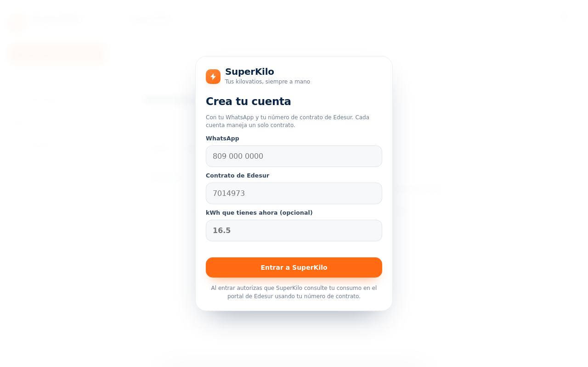
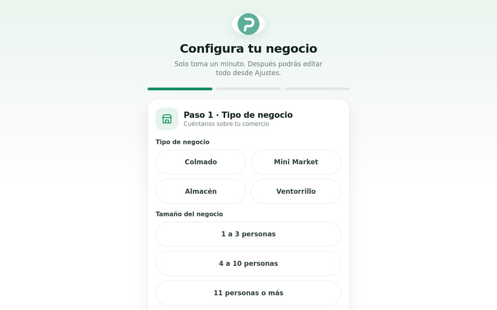
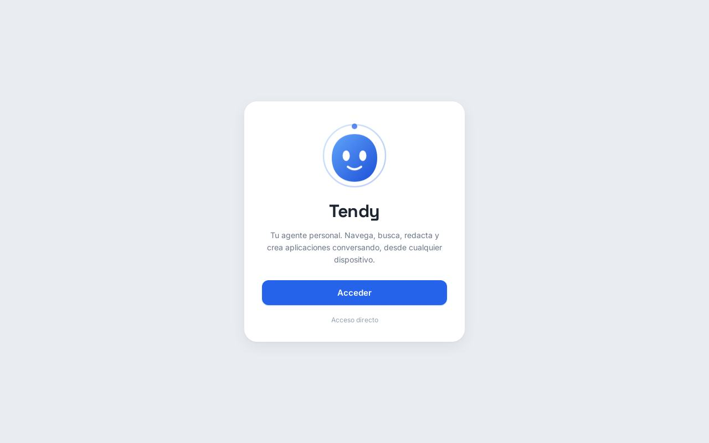

<div align="center">


# DGTech · Ecosistema de aplicaciones

**Todas tus aplicaciones en un solo lugar. Vistas previas reales, un clic para abrir.**

[](https://mingo20.github.io/dtech/)
[](https://mingo20.github.io/dtech/)
[](https://mingo20.github.io/dtech/)
[](https://mingo20.github.io/dtech/)

<a href="https://mingo20.github.io/dtech/">
  
  
  
</a>

</div>

---

## Qué es esto

Un lanzador de aplicaciones web. Cada app se ve antes de abrirla, con captura real, categoría y descripción. Sin instalaciones, sin tiendas, sin fricción.

- **Búsqueda instantánea** con `⌘K` / `Ctrl K`
- **Filtros por categoría**: Energía, Comercio, Educación, IA y agentes, Legal, Facturación, Audio, Datos y campo
- **Vista previa** en modal con captura real y funciones clave
- **Instalable** como PWA, tema oscuro y animaciones con respeto a `prefers-reduced-motion`

## Las 16 aplicaciones

| Aplicación | Categoría | Qué resuelve |
| --- | --- | --- |
| **[SuperKilo](https://mingo20.github.io/prekilo/)** | Energía | Consumo real del medidor Edesur, proyección de factura y alertas de irregularidad |
| **[PediPOS](https://mingo20.github.io/pedipos/)** | Comercio | Punto de venta por voz, ITBIS 18%, funciona sin internet |
| **[Tendy](https://mingo20.github.io/tendy/)** | IA y agentes | Agente personal con avatar que navega, busca y redacta por ti |
| **[FirmAbal](https://mingo20.github.io/firmabal-pwa/)** | Datos y campo | Captura territorial con validación de cédula y firma manuscrita |
| **[Forja](https://mingo20.github.io/forja-chat/)** | IA y agentes | Agente conversacional que construye aplicaciones |
| **[Panel Docente](https://mingo20.github.io/colegio-reformado-esperanza/)** | Educación | Planificaciones, asistencia, calificaciones y supervisión |
| **[Plan de Clase](https://mingo20.github.io/planes-clase-colegio-esperanza/)** | Educación | Ejemplo de planificación diaria con estructura oficial |
| **[LexGoAI](https://mingo20.github.io/lexgoai/)** | Legal | Asistencia jurídica digital con agentes especializados |
| **[FAC IA](https://mingo20.github.io/fac-ia-pwa/)** | Facturación | Facturación electrónica inteligente, alineada con la DGII |
| **[TranscribeAI Pro](https://mingo20.github.io/transcribeai-pro/)** | Audio | Transcripción profesional de audio con IA |
| **[NeuroLearn AI](https://mingo20.github.io/neurolearn-ai/)** | Educación | Aprende IA desde cero hasta agentes |
| **[Skios Educativo](https://mingo20.github.io/skios-educativo/)** | Educación | Menos burocracia para el docente dominicano |
| **[Andrea IA](https://mingo20.github.io/andrea-ia-pwa/)** | IA y agentes | Asistente de voz y chat instalable |
| **[POSChat IA](https://mingo20.github.io/poschat-agent-ui/)** | Comercio | Chat agéntico para punto de venta |
| **[Agentia](https://mingo20.github.io/agentia/)** | IA y agentes | Automatización de negocio desde WhatsApp |
| **[Delega IA](https://mingo20.github.io/delegaia/)** | IA y agentes | Agente operativo disponible 24/7 |

## Cómo está hecho

`HTML` · `CSS` · `JavaScript` sin frameworks · GitHub Pages · PWA con manifiesto e iconos

Sin dependencias externas, sin CDN: carga instantánea incluso con datos móviles lentos.

## Correr local

```bash
git clone https://github.com/Mingo20/dtech.git
cd dtech
python3 -m http.server 8099
# abre http://localhost:8099
```

## Contacto

WhatsApp [+1 829 646 9885](https://wa.me/18296469885) · República Dominicana

<div align="center">
<sub>DGTech · 2026 · Hecho con intención en República Dominicana</sub>
</div>
